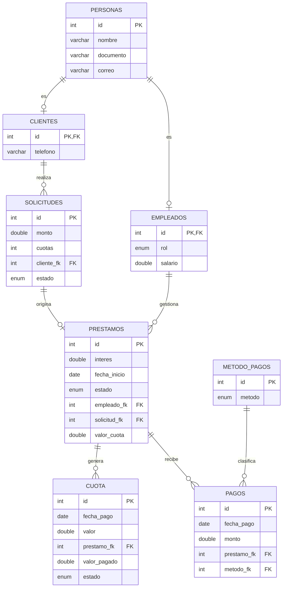

# CrediYa - Sistema de Gestión de Créditos

## 1. Descripción del proyecto

**CrediYa** es una aplicación de escritorio basada en consola, desarrollada en Java y conectada a una base de datos MySQL mediante JDBC. Su finalidad es administrar los procesos de una entidad dedicada al otorgamiento y gestión de créditos.

El sistema permite administrar clientes, empleados, solicitudes, préstamos, cuotas y pagos. También incorpora un mecanismo de inicio de sesión, registro de actividades mediante una bitácora y generación de reportes para consultar el comportamiento general del sistema.

El proyecto está desarrollado aplicando principios de programación orientada a objetos, separación de responsabilidades y patrones de diseño, buscando que el código sea organizado, reutilizable, mantenible y fácil de ampliar.

### Objetivos principales

- Administrar la información de clientes y empleados.
- Registrar y gestionar solicitudes de crédito.
- Convertir solicitudes aprobadas en préstamos.
- Generar y almacenar las cuotas correspondientes a cada préstamo.
- Registrar pagos completos y abonos parciales.
- Consultar el historial de pagos de los préstamos.
- Identificar clientes con obligaciones pendientes y cuotas vencidas.
## 2. Tecnologías utilizadas

| Tecnología | Utilización |
|---|---|
| JDBC | Conexión y comunicación entre Java y MySQL. |
| MySQL Connector/J 9.7.0 | Controlador JDBC para MySQL. |
| Java Serialization | Persistencia y exportación de respaldos mediante archivos `.dat`. |
| Java Stream API | Procesamiento, filtrado y organización de información para reportes. |
| Lambda Expressions | Operaciones funcionales sobre colecciones. |
| Swing JFileChooser | Selección de archivos para exportaciones y respaldos. |

### Requisitos para ejecutar el proyecto

- JDK 21 o superior compatible con la configuración del proyecto.
- Apache Maven.
- MySQL Server 8.0 o superior.
- Un entorno de desarrollo como Apache NetBeans, IntelliJ IDEA o Eclipse.
- Base de datos `creditos` creada y configurada.

---

## 3. Arquitectura del sistema

El proyecto utiliza una organización basada en el patrón arquitectónico **MVC (Modelo - Vista - Controlador)**, complementada con una capa DAO para el acceso a datos y una capa de gestión para la persistencia y coordinación de determinadas operaciones.

La separación de responsabilidades permite que las reglas del negocio, las consultas SQL, la presentación de información y el flujo de ejecución no estén concentrados en una sola clase.

### 3.1. Modelo (`model`)

Contiene las entidades que representan los objetos principales del sistema y las clases encargadas de la gestión y los servicios del negocio.

#### `model.entity`

Contiene las clases que representan las entidades del sistema:

- `personas`: clase base que almacena la información general de una persona.
- `clientes`: representa a los clientes y extiende la clase `personas`.
- `empleados`: representa a los empleados y sus datos laborales.
- `Solicitudes`: representa las solicitudes de crédito realizadas por los clientes.
- `prestamos`: representa los préstamos registrados en el sistema.
- `cuota`: representa cada cuota asociada a un préstamo.
- `pago`: representa los pagos y abonos realizados.
- `sesion`: administra la información de la sesión activa.
- `registroAccion`: representa los movimientos registrados en la bitácora.
- `ReporteGenerado`: representa los reportes almacenados.
- `rol`: contiene la definición de los roles utilizados por el sistema.

#### `model.gestion`

Contiene las clases responsables de coordinar la persistencia y sincronización de información.

Entre ellas se encuentran:

- `gestionPersonas`
- `gestionSolicitudes`
- `gestionPrestamos`
- `gestionPagos`
- `gestionReportes`
- `Almacen`

Estas clases permiten administrar colecciones y respaldos serializados cuando corresponde.

#### `model.service`

Contiene servicios y componentes que implementan reglas específicas del negocio.

- `ManejadorSolicitud`: estructura base para el procesamiento de solicitudes.
- `asesorHandler`: maneja determinadas solicitudes según sus condiciones.
- `analistaHandler`: procesa solicitudes que requieren otro nivel de evaluación.
- `gerenteHandler`: representa el nivel superior de aprobación.
- `bitacora`: centraliza el registro de las operaciones realizadas.
- `seguridad`: administra la validación de la clave general utilizada para el acceso de administradores.

### 3.2. Acceso a datos (`dao`)

La capa DAO (Data Access Object) contiene las operaciones necesarias para comunicarse con MySQL.

Cada DAO concentra las consultas SQL y las operaciones de inserción, búsqueda, actualización y consulta de información.

Clases principales:
| Java 21 | Lenguaje principal de programación. |
| Maven | Administración de dependencias y construcción del proyecto. |
| MySQL | Sistema gestor de base de datos. |

- `clienteDao`
- `empleadoDao`

---

- `solicitudDao`
- `prestamoDao`
- `cuotaDao`
- `pagoDao`
- `auditoriaDao`
- `reporteDao`

Esta separación evita colocar consultas SQL directamente en los controladores y facilita el mantenimiento de la persistencia.
- Controlar el acceso de usuarios al sistema.
- Registrar las operaciones realizadas por empleados y clientes.
- Mantener la información persistente mediante MySQL y archivos de respaldo.

### 3.3. Controladores (`controller`)

Los controladores coordinan la interacción entre las vistas, los DAO, las entidades y las clases de gestión.


Clases principales:

- `controllerMenugeneral`: administra el flujo principal de la aplicación.
- `controllerLogin`: controla el inicio y cierre de sesión.
- `controllerGestionCliente`: coordina las operaciones de clientes.
- `controllerGestionEmpleado`: coordina las operaciones de empleados.
- `controllerGestionSolicitud`: coordina la gestión de solicitudes.
- `controllerGestionPrestamo`: coordina la gestión de préstamos.
- `controllerGestionPago`: administra las operaciones de pagos y consultas.
- `controllerReportes`: coordina la generación y presentación de reportes.
- `controllerMenuCliente`: administra las opciones disponibles para clientes.
- `controllerMenuEmpleados`: administra las opciones disponibles para empleados.

### 3.4. Vistas (`view`)

Contiene las clases encargadas de mostrar los menús, solicitar información y validar las entradas del usuario.

Se organiza principalmente en:

- `view.menus`: menús de navegación del sistema.
- `view.ingresos`: clases para solicitar datos al usuario.
- `view.mensajes`: presentación de mensajes informativos, errores y confirmaciones.
- `view.validaciones`: validaciones de entradas y datos suministrados.

### 3.5. Conexión y excepciones

- `database.conecction`: administra la configuración y creación de conexiones JDBC mediante un Singleton.
- `exception.ConfiguracionException`: representa errores relacionados con la configuración de conexión.

---

## 4. Funcionalidades del sistema

### 4.1. Gestión de personas

El sistema utiliza una clase general `personas`, de la cual heredan clientes y empleados.

La información común se centraliza en esta clase:

- Identificador.
- Nombre.
- Documento.
- Correo electrónico.

Los clientes y empleados agregan sus atributos específicos.

Esta estructura permite reutilizar atributos y comportamientos comunes, evitando duplicar información.

### 4.2. Gestión de clientes

Permite administrar la información de los clientes.

Entre sus operaciones se encuentran:

- Registrar clientes.
- Consultar clientes.
- Listar clientes.
- Actualizar información.
- Eliminar registros cuando las relaciones existentes lo permiten.
- Consultar los préstamos asociados a un cliente.
- Consultar información relacionada con sus solicitudes y obligaciones.

Los clientes se identifican mediante su ID, que también corresponde al identificador de su registro en la tabla `personas`.

### 4.3. Gestión de empleados

Permite administrar los empleados que participan en las operaciones de la entidad.

Se contemplan los siguientes roles:

- `ADMINISTRADOR`
- `EMPLEADO`

Cada empleado está relacionado con un registro de la tabla `personas`.

El sistema permite administrar información laboral y consultar la actividad registrada de los empleados mediante la bitácora y los reportes.

### 4.4. Inicio de sesión

El sistema presenta un menú general que permite ingresar como empleado, ingresar como cliente o salir de la aplicación.

**Acceso de empleados**

- Se muestran los empleados registrados con rol `ADMINISTRADOR`.
- El usuario selecciona su identificador.
- Se solicita la clave general del sistema.
- Se permiten hasta tres intentos.
- Si no existe ningún administrador, se habilita el registro del primero mediante la validación de la clave general.

**Acceso de clientes**

- Se muestran los clientes registrados.
- El cliente selecciona su ID.
- El sistema valida que el identificador exista.
- Se inicia la sesión correspondiente.

La versión actual utiliza una clave general compartida para los administradores. No implementa todavía contraseñas individuales para cada empleado ni contraseña individual para los clientes.

La sesión permite identificar quién está utilizando el sistema y asociar sus operaciones a la bitácora.

### 4.5. Gestión de solicitudes

Permite registrar y consultar las solicitudes de crédito realizadas por los clientes.

Cada solicitud se relaciona con un cliente y contiene información como:

- Identificador.
- Monto solicitado.
- Número de cuotas.
- Cliente asociado.
- Estado de la solicitud.

Los estados utilizados son:

- `PENDIENTE`
- `UTILIZADA`

Una solicitud disponible puede convertirse en un préstamo.

Cuando se registra correctamente un préstamo, la solicitud cambia a estado `UTILIZADA`, evitando que vuelva a utilizarse para generar otro préstamo.

La solicitud no necesita eliminarse para dejar de aparecer en el listado de solicitudes disponibles.

### 4.6. Gestión de préstamos

El módulo de préstamos permite convertir una solicitud disponible en una obligación crediticia asociada a un cliente.

Cada préstamo contiene:

- Identificador.
- Tasa de interés.
- Fecha de inicio.
- Estado.
- Empleado responsable.
- Solicitud de origen.
- Cuotas asociadas.

Los estados principales son:

- `ACTIVO`
- `PAGADO`

Para registrar un préstamo, el sistema solicita y valida:

1. Una solicitud disponible.
2. Un empleado responsable.
3. La tasa de interés.

Una vez registrado, el préstamo queda relacionado con la solicitud y el empleado seleccionados.

El módulo permite:

- Registrar préstamos.
- Listar préstamos.
- Buscar préstamos por identificador.
- Consultar préstamos asociados a un cliente.
- Consultar las cuotas de cada préstamo.
- Exportar respaldos de la información.

### 4.7. Gestión de cuotas

La tabla `cuota` permite almacenar individualmente las cuotas correspondientes a cada préstamo.

Cada cuota contiene:

- Identificador.
- Fecha de pago.
- Valor de la cuota.
- Identificador del préstamo asociado.
- Valor pagado.
- Estado.

Los campos `valor_pagado` y `estado` se incorporan mediante la migración del módulo de pagos.

Los estados de una cuota son:

- `PENDIENTE`
- `PAGADA`

Las cuotas se relacionan con un préstamo mediante la llave foránea `prestamo_fk`.

De esta manera, un préstamo puede tener múltiples cuotas y cada cuota pertenece a un único préstamo.

La información de las cuotas permite consultar el valor programado, los abonos acumulados y el saldo pendiente.

**Nota sobre el cálculo financiero:** la fórmula implementada actualmente en la entidad `prestamos` corresponde a interés simple distribuido entre el número de cuotas. La implementación de amortización con interés compuesto mensual y su correspondiente generación de cuotas debe incorporarse antes de considerar esa modalidad como disponible.

### 4.8. Gestión de pagos

El módulo de pagos permite registrar operaciones relacionadas con las obligaciones de los préstamos.

Se contemplan dos operaciones principales:

**Pagar una cuota**

- Se identifica el préstamo.
- Se consulta la primera cuota pendiente.
- Se muestra el saldo de la cuota.
- Se solicita confirmación.
- Se selecciona el método de pago.
- Se registra el pago.

**Realizar un abono**

- Se identifica el préstamo.
- Se consulta el saldo pendiente.
- Se ingresa el monto que se desea abonar.
- Se valida que el monto sea positivo y no supere la deuda.
- Se selecciona el método de pago.
- Se registra el abono.

Los abonos se distribuyen desde la cuota pendiente más antigua hacia las siguientes, actualizando el valor pagado y el estado de cada cuota.

Los métodos de pago contemplados son:

- `EFECTIVO`
- `TRANSFERENCIA`
- `TARJETA`
- `CONSIGNACION`

El DAO de pagos utiliza transacciones para mantener consistentes las operaciones de registro del pago, actualización de cuotas y actualización del estado del préstamo.

Cuando todas las cuotas quedan pagadas, el préstamo cambia automáticamente a estado `PAGADO`.

**Historial de pagos**

El sistema permite consultar los pagos realizados a un préstamo, incluyendo:

- Identificador del pago.
- Fecha.
- Monto.
- Préstamo asociado.
- Método de pago.

La consulta se realiza a partir del identificador del préstamo, que permite llegar al cliente correspondiente.

En el menú de consulta de pagos para empleados se encuentra disponible la consulta del historial. Las operaciones de cobro y abono están disponibles en el controlador general del módulo de pagos, pero no en ese menú de consulta.

### 4.9. Bitácora y auditoría

El sistema incorpora una bitácora para registrar las actividades realizadas durante el uso de la aplicación.

La información se almacena en la tabla `auditoria`.

Cada registro puede contener:

- Identificador del movimiento.
- Fecha y hora.
- Identificador del usuario.
- Nombre del usuario.
- Tipo de usuario.
- Módulo afectado.
- Acción realizada.
- Descripción de la operación.

Se contemplan actividades relacionadas con:

- Inicio y cierre de sesión.
- Intentos de acceso incorrectos.
- Gestión de empleados.
- Gestión de clientes.
- Gestión de solicitudes.
- Gestión de préstamos.
- Gestión de pagos.
- Consultas y generación de reportes.

La bitácora conserva el nombre y el identificador del usuario para mantener el historial incluso si posteriormente se elimina su registro principal.

La creación de la tabla de auditoría se realiza automáticamente desde la aplicación o puede ejecutarse manualmente mediante el archivo `auditoria.sql`.

El registro de auditoría está diseñado para no interrumpir una operación principal cuando ocurre un problema al guardar un movimiento.

### 4.10. Módulo de reportes

El módulo de reportes permite consultar información general y detallada del funcionamiento de la entidad.

Su objetivo es facilitar el seguimiento de las operaciones y proporcionar información útil para la administración.

Se utilizan consultas a MySQL y procesamiento de colecciones mediante Stream API y expresiones lambda.

Entre las operaciones funcionales utilizadas se encuentran:

- `stream()`
- `filter()`
- `map()`
- `count()`
- `collect()`
- `forEach()`
- `IntStream`
- `Collectors.joining()`

Los reportes disponibles se organizan de la siguiente manera:

| Opción | Reporte | Información |
|---|---|---|
| 1 | Acciones de empleados | Resumen y detalle de las actividades por empleado. |
| 2 | Acciones de clientes | Resumen y detalle de las actividades por cliente. |
| 3 | Acciones por módulo | Cantidad y detalle de movimientos por módulo. |
| 4 | Últimos movimientos | Últimos 30 movimientos registrados. |
| 5 | Reporte de empleados | Cantidad por rol, nómina y préstamos gestionados. |
| 6 | Reporte de clientes | Solicitudes, préstamos, capital prestado y deuda pendiente. |
| 7 | Reporte de solicitudes | Totales, promedios y estados de las solicitudes. |
| 8 | Reporte de préstamos | Capital, intereses, recaudo, saldo por cobrar y estados. |
| 9 | Reporte de pagos y cuotas | Métodos de pago, movimientos por mes y cuotas vencidas. |
| 10 | Resumen general | Indicadores generales del sistema. |

Los reportes generales pueden almacenarse en la tabla `reportes_generados` y también en el archivo `reportesfinal.dat`.

La información de auditoría se consulta desde la base de datos y permite conocer las acciones realizadas por cada usuario.

### 4.11. Identificación de clientes morosos

El módulo de reportes permite identificar obligaciones pendientes y cuotas vencidas.

Para determinar si una cuota se encuentra en mora se debe considerar:

- La fecha de vencimiento.
- El saldo pendiente de la cuota.
- El estado de la cuota.

Una cuota se considera vencida cuando su fecha de pago es anterior a la fecha actual y todavía presenta un saldo pendiente.

El reporte permite consultar información relacionada con las obligaciones de los clientes y su deuda pendiente.

---

## 5. Base de datos

El sistema utiliza una base de datos relacional denominada `creditos`.

La conexión se realiza mediante JDBC y las relaciones se administran utilizando llaves primarias y foráneas.

### 5.1. Diagrama lógico de relaciones



### 5.2. Descripción de las tablas

| Tabla | Responsabilidad |
|---|---|
| `personas` | Almacena los datos generales de las personas. |
| `clientes` | Almacena los datos específicos de los clientes. |
| `empleados` | Almacena los datos laborales y el rol de los empleados. |
| `solicitudes` | Registra las solicitudes de crédito. |
| `prestamos` | Almacena los préstamos aprobados y registrados. |
| `cuota` | Almacena las cuotas individuales de cada préstamo. |
| `pagos` | Registra los pagos y abonos realizados. |
| `metodo_pagos` | Contiene los métodos de pago disponibles. |
| `auditoria` | Registra las operaciones realizadas por los usuarios. |
| `reportes_generados` | Almacena los reportes generales generados. |

### 5.3. Relaciones principales

- Una persona puede estar registrada como cliente o empleado.
- Un cliente puede realizar varias solicitudes.
- Una solicitud puede originar un préstamo.
- Un empleado puede gestionar varios préstamos.
- Un préstamo puede tener múltiples cuotas.
- Un préstamo puede recibir múltiples pagos.
- Cada pago utiliza un método de pago.
- La auditoría conserva el historial de actividades de los usuarios.

---

## 6. Instalación y configuración

### 6.1. Clonar o descargar el proyecto

Descargar el proyecto y abrir la carpeta `APROYECTO` desde el entorno de desarrollo.

La carpeta principal debe contener el archivo `pom.xml`.

### 6.2. Crear la base de datos

Abrir MySQL Workbench o el cliente de MySQL y ejecutar el script de creación del esquema `creditos` y sus tablas principales.

```sql
CREATE SCHEMA IF NOT EXISTS creditos
DEFAULT CHARACTER SET utf8mb4
COLLATE utf8mb4_0900_ai_ci;

USE creditos;
```

Después, ejecutar el resto de las instrucciones SQL correspondientes a las tablas del sistema.

**Importante:** las tablas principales deben existir antes de ejecutar las migraciones de pagos y auditoría.

### 6.3. Ejecutar la migración de pagos

El módulo de pagos necesita que la tabla `cuota` tenga los campos `valor_pagado` y `estado`.

El archivo `pagos.sql` contiene la migración correspondiente.

Antes de ejecutarlo, verificar que la primera instrucción sea:

```sql
USE creditos;
```

No utilizar `crediya`, ya que el esquema del proyecto se denomina `creditos`.

Ejecutar la migración una sola vez. Si las columnas ya existen, no se deben volver a agregar.

La migración incorpora:

```sql
ALTER TABLE cuota
    ADD COLUMN valor_pagado DOUBLE NOT NULL DEFAULT 0,
    ADD COLUMN estado ENUM('PENDIENTE', 'PAGADA')
        NOT NULL DEFAULT 'PENDIENTE';
```

### 6.4. Crear la tabla de auditoría

La tabla `auditoria` se puede crear automáticamente desde la aplicación.

También se puede ejecutar manualmente el archivo:

```text
auditoria.sql
```

Este archivo contiene la definición de la tabla utilizada para registrar los movimientos del sistema.

### 6.5. Configurar la conexión a MySQL

El proyecto utiliza la clase:

```text
database.conecction
```

La configuración se obtiene de las variables de entorno o del archivo `db.properties`.

El orden de prioridad es:

1. Variables de entorno.
2. Archivo `db.properties`.

Ejemplo de archivo local `db.properties`:

```properties
url=jdbc:mysql://localhost:3306/creditos
usuario=root
clave=TU_CLAVE_LOCAL
```

También se pueden configurar las siguientes variables de entorno:

```text
DB_URL
DB_USUARIO
DB_CLAVE
```

Para indicar una ruta diferente del archivo de configuración:

```text
DB_CONFIG
```

**Seguridad:** el archivo `db.properties` está incluido en `.gitignore`. No se deben publicar contraseñas ni credenciales reales en repositorios.

Se recomienda utilizar credenciales propias para la aplicación y no utilizar la contraseña de una cuenta personal o administrativa de MySQL.

### 6.6. Configurar la clave general de acceso

La clave general de administradores se administra desde:

```text
model.service.seguridad
```

También se puede establecer mediante la variable de entorno:

```text
CLAVE_GENERAL
```

La variable de entorno tiene prioridad sobre la clave predeterminada del código.

Antes de utilizar el sistema fuera de un entorno académico o de pruebas, se debe reemplazar la clave predeterminada por una clave segura.

### 6.7. Descargar dependencias

El proyecto utiliza Maven para administrar sus dependencias.

Desde una terminal ubicada en la carpeta principal se puede ejecutar:

```bash
mvn clean install
```

Para compilar:

```bash
mvn clean compile
```

---

## 7. Ejecución del proyecto

La clase principal de la aplicación es:

```text
com.javaprojects.aproyecto.APROYECTO
```

Contiene el método `main`, encargado de iniciar el controlador del menú general.

Desde Maven se puede ejecutar:

```bash
mvn exec:java
```

También se puede ejecutar directamente desde NetBeans, IntelliJ IDEA o Eclipse seleccionando la clase principal.

Al iniciar, el sistema presenta el menú general de acceso:

1. Ingresar como empleado.
2. Ingresar como cliente.
3. Salir.

Las opciones disponibles dependen del tipo de usuario y de su rol.

---

## 8. Persistencia y respaldos

El sistema utiliza MySQL como mecanismo principal de persistencia.

Adicionalmente, algunas clases de gestión utilizan serialización de objetos Java para almacenar respaldos locales.

Entre los archivos utilizados se encuentran:

| Archivo | Contenido |
|---|---|
| `personasfinal.dat` | Respaldo de personas. |
| `solicitudesfinall.dat` | Respaldo de solicitudes. |
| `prestamosfinall.dat` | Respaldo de préstamos. |
| `pagosfinal.dat` | Respaldo de pagos. |
| `reportesfinal.dat` | Respaldo de reportes generales. |

Los archivos `.dat` son archivos binarios serializados.

No deben modificarse manualmente con un editor de texto.

Estos archivos funcionan como respaldos locales y no sustituyen la base de datos MySQL.

Para garantizar la integridad de la información, las operaciones transaccionales deben realizarse sobre la base de datos.

---

## 9. Principios de diseño y patrones utilizados

### 9.1. Programación orientada a objetos

El sistema utiliza los principales fundamentos de la programación orientada a objetos:

**Encapsulamiento**

Los atributos de las entidades se mantienen privados y se accede a ellos mediante métodos públicos.

**Herencia**

La clase `clientes` y la clase `empleados` extienden la clase `personas`, reutilizando sus atributos generales.

**Abstracción**

Las clases representan entidades y responsabilidades específicas del dominio de créditos.

**Polimorfismo**

Se utiliza en la estructura de manejo de solicitudes mediante la clase base `ManejadorSolicitud` y sus implementaciones.

### 9.2. Patrón MVC

Separa el modelo de datos, la presentación y el flujo de ejecución.

Permite mantener los controladores organizados y evitar que las vistas accedan directamente a la base de datos.

### 9.3. Patrón DAO

Cada DAO concentra las operaciones de acceso a datos de una entidad o módulo.

Esto permite separar las consultas SQL de las reglas de negocio y de la presentación.

### 9.4. Patrón Singleton

La clase `database.conecction` utiliza Singleton para mantener una instancia centralizada de la configuración de conexión.

La conexión JDBC propiamente dicha se crea mediante el método `conectar()`.

### 9.5. Patrón Chain of Responsibility

Se utiliza en el procesamiento de solicitudes.

Las solicitudes pueden pasar por diferentes manejadores, permitiendo distribuir las responsabilidades de evaluación y aprobación.

### 9.6. Principios SOLID

El diseño busca aplicar los principios SOLID:

- **S - Single Responsibility Principle:** cada clase debe tener una responsabilidad principal.
- **O - Open/Closed Principle:** las funcionalidades deben poder ampliarse procurando evitar modificaciones innecesarias de componentes existentes.
- **L - Liskov Substitution Principle:** las clases derivadas deben conservar el comportamiento esperado de sus clases base.
- **I - Interface Segregation Principle:** las dependencias deben mantenerse específicas y no obligar a las clases a implementar operaciones que no necesitan.
- **D - Dependency Inversion Principle:** los componentes de alto nivel deben evitar depender directamente de detalles de implementación.

La aplicación de estos principios se realiza de forma progresiva y debe mantenerse durante futuras ampliaciones del sistema.

---

## 10. Validaciones y manejo de errores

El sistema incorpora validaciones para reducir errores durante el ingreso de información y la ejecución de operaciones.

Entre las validaciones contempladas se encuentran:

- Verificar que los identificadores correspondan a registros existentes.
- Validar que las solicitudes estén disponibles antes de generar préstamos.
- Comprobar que los montos sean válidos.
- Evitar valores de pago negativos o iguales a cero.
- Evitar abonos superiores al saldo pendiente.
- Validar que los préstamos estén activos antes de registrar pagos.
- Verificar los métodos de pago.
- Validar las opciones de los menús.
- Controlar los intentos de acceso.
- Manejar errores de conexión y consultas SQL.

La clase `ConfiguracionException` permite representar problemas relacionados con la configuración de la conexión.

Las operaciones que modifican varias tablas relacionadas utilizan transacciones JDBC cuando corresponde.

El objetivo es evitar que una operación incompleta deje información inconsistente en la base de datos.

---

## 11. Estructura del proyecto

La estructura principal es la siguiente:

```text
APROYECTO/
│
├── src/
│   ├── main/
│   │   └── java/
│   │       │
│   │       ├── com/
│   │       │   └── javaprojects/
│   │       │       └── aproyecto/
│   │       │           └── APROYECTO.java
│   │       │
│   │       ├── database/
│   │       │   └── conecction.java
│   │       │
│   │       ├── dao/
│   │       │   ├── clienteDao.java
│   │       │   ├── empleadoDao.java
│   │       │   ├── solicitudDao.java
│   │       │   ├── prestamoDao.java
│   │       │   ├── cuotaDao.java
│   │       │   ├── pagoDao.java
│   │       │   ├── auditoriaDao.java
│   │       │   └── reporteDao.java
│   │       │
│   │       ├── controller/
│   │       │   ├── controllerLogin.java
│   │       │   ├── controllerMenugeneral.java
│   │       │   ├── controllerGestionCliente.java
│   │       │   ├── controllerGestionEmpleado.java
│   │       │   ├── controllerGestionSolicitud.java
│   │       │   ├── controllerGestionPrestamo.java
│   │       │   ├── controllerGestionPago.java
│   │       │   ├── controllerReportes.java
│   │       │   ├── controllerMenuCliente.java
│   │       │   └── controllerMenuEmpleados.java
│   │       │
│   │       ├── exception/
│   │       │   └── ConfiguracionException.java
│   │       │
│   │       ├── model/
│   │       │   ├── entity/
│   │       │   ├── gestion/
│   │       │   └── service/
│   │       │
│   │       └── view/
│   │           ├── ingresos/
│   │           ├── menus/
│   │           ├── mensajes.java
│   │           └── validaciones.java
│   │
│   └── test/
│       └── java/
│
├── auditoria.sql
├── pagos.sql
├── db.properties
├── pom.xml
└── README.md
```

---

## 12. Consideraciones importantes

1. La base de datos MySQL es la fuente principal de información del sistema.
2. Los archivos `.dat` son respaldos serializados y no sustituyen la persistencia relacional.
3. La clave general actual es compartida por los administradores; el acceso individual mediante contraseña es una mejora pendiente.
4. El acceso de clientes utiliza su identificador, sin contraseña individual.
5. Las operaciones de pago y abono están implementadas en el DAO y en el controlador general del módulo.
6. El menú de consulta de pagos para empleados está limitado a consultar historiales.
7. La fórmula actual de generación de cuotas en `prestamos.java` utiliza interés simple. La amortización con interés compuesto mensual requiere una implementación adicional.
8. Antes de ejecutar las migraciones SQL, se debe comprobar que no se hayan agregado previamente las columnas correspondientes.
9. Se recomienda realizar copias de seguridad antes de modificar la estructura de la base de datos.
10. El sistema está orientado a fines académicos y de aprendizaje. Para su uso en un entorno financiero real se requieren controles adicionales de seguridad, auditoría, precisión monetaria y validación de las reglas financieras.

---

## 13. Mejoras futuras

El proyecto puede ampliarse incorporando nuevas funcionalidades:

- Contraseñas individuales para cada empleado.
- Autenticación individual para clientes.
- Recuperación y cambio de contraseñas.
- Gestión avanzada de permisos según roles.
- Implementación completa de interés compuesto y amortización.
- Generación automática de cuotas con fechas configurables.
- Historial detallado de abonos por cuota.
- Identificación de mora y cálculo de intereses moratorios.
- Exportación de reportes a PDF y Excel.
- Interfaz gráfica para facilitar la interacción.
- Pruebas unitarias y pruebas de integración.
- Registro de cambios con información anterior y nueva.
- Mejoras en la gestión de excepciones y validaciones.

---

## 14. Autoría

**Proyecto:** CrediYa - Sistema de Gestión de Créditos.

**Tecnologías principales:** Java, Maven, MySQL y JDBC.

**Arquitectura:** MVC con capa DAO y servicios de gestión.

**Propósito:** Proyecto académico orientado a la aplicación de programación orientada a objetos, patrones de diseño, persistencia relacional y desarrollo de software modular.

---

## 15. Licencia y uso

Este proyecto se desarrolla con fines académicos y educativos.

Su código puede utilizarse como referencia para el aprendizaje de Java, JDBC, MySQL, arquitectura MVC, patrones de diseño y programación orientada a objetos, respetando las condiciones de uso y distribución que establezca su autor.
